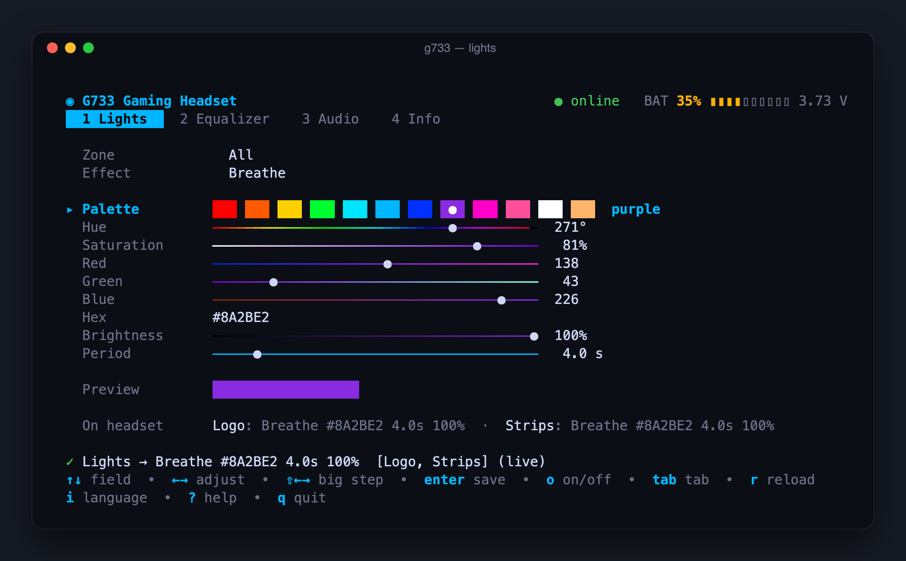
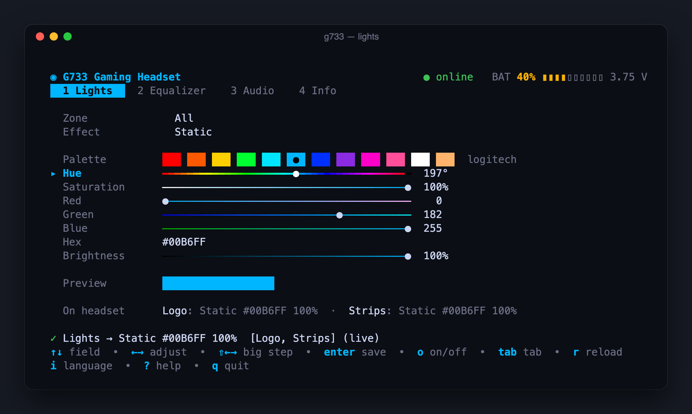
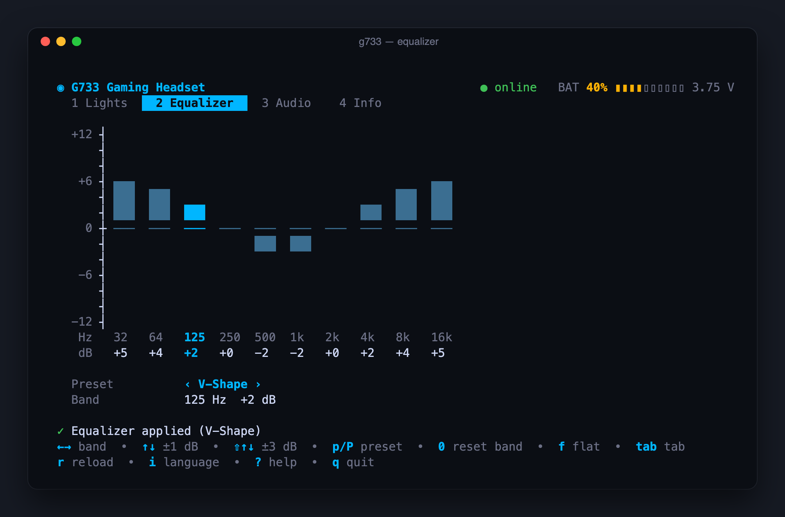
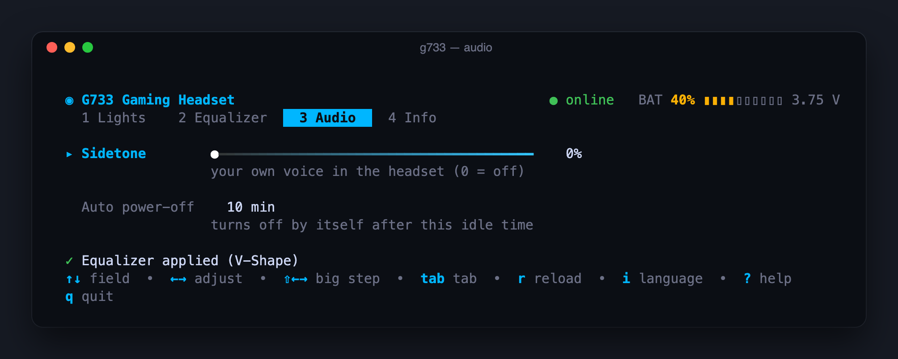
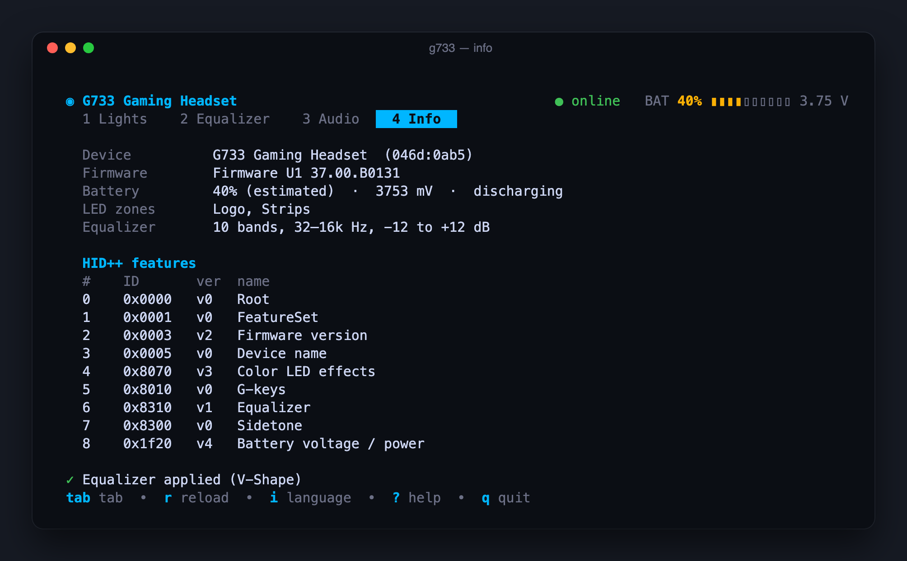
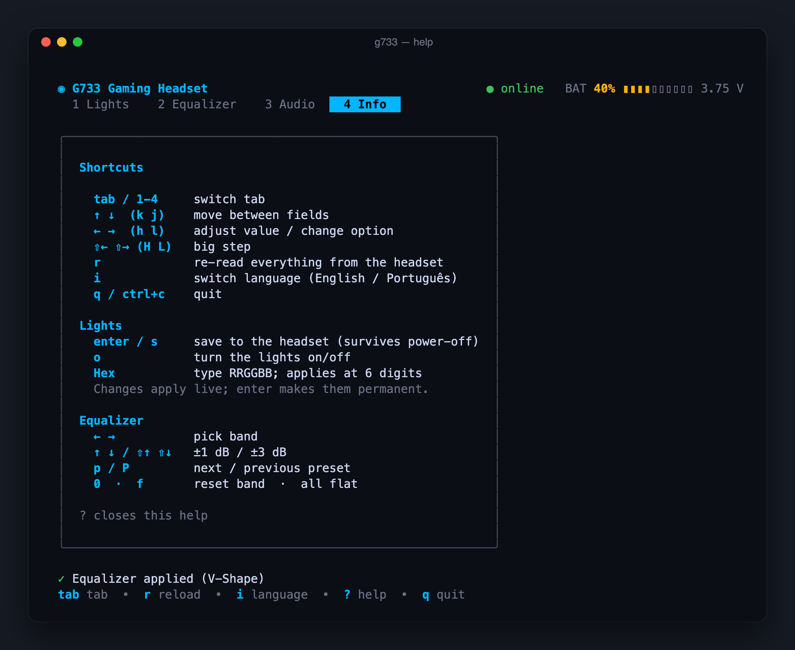
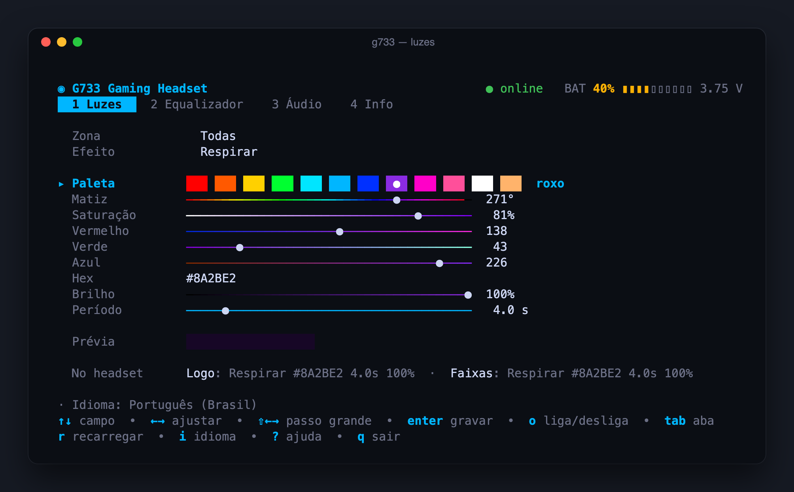
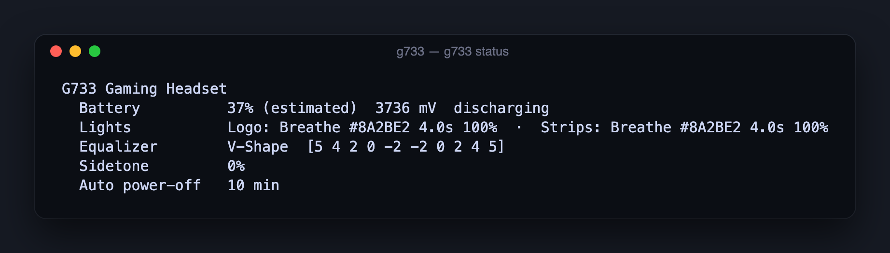

# g733 — Logitech G733 control without G HUB

**English** · [Português (Brasil)](README.pt-BR.md)

A small, fast terminal app that talks **HID++ 2.0** straight to the Logitech
G733 LIGHTSPEED dongle. Change the RGB lights, equalizer, sidetone and
auto power-off, and read the battery, without installing Logitech G HUB.



- **Interactive UI** built with [Bubble Tea](https://github.com/charmbracelet/bubbletea):
  live RGB editor with palette, hue/saturation/RGB sliders, hex input and an
  animated preview; a 10-band graphic equalizer with presets; and more.
- **One-shot CLI** for scripts, aliases and global hotkeys
  (`g733 lights off`, `g733 eq preset bass`…).
- **English and Brazilian Portuguese**, switchable at any time.
- **Self-contained binary** (hidapi is compiled in) that never takes exclusive
  access to the dongle, so the headset's volume wheel and media keys keep
  working while it runs.

## Contents

- [Requirements](#requirements)
- [Install](#install)
- [Quick start](#quick-start)
- [Using the interactive UI](#using-the-interactive-ui)
- [Using the CLI](#using-the-cli)
- [Language](#language)
- [Automation ideas](#automation-ideas)
- [How it works](#how-it-works)
- [Troubleshooting](#troubleshooting)

## Requirements

- Logitech **G733** with its LIGHTSPEED USB receiver (USB IDs `046d:0ab5`,
  `0afe` or `0b1f`).
- **macOS** (developed and tested on Apple Silicon). The HID layer
  ([go-hid](https://github.com/sstallion/go-hid)) also supports Linux and
  Windows, but those platforms are untested.
- **Go 1.25+** with cgo (Xcode Command Line Tools on macOS) to build.

## Install

```bash
go install github.com/felipearomani/g733-control/cmd/g733@latest
```

The binary lands in `$(go env GOPATH)/bin` (usually `~/go/bin`). Make sure
that directory is on your `PATH`.

Or from a clone:

```bash
git clone https://github.com/felipearomani/g733-control.git
cd g733-control
make install      # builds and installs ~/go/bin/g733
make test         # unit tests (no headset needed)
```

## Quick start

1. Plug in the LIGHTSPEED receiver and turn the headset on.
2. Run `g733`. The header turns green (**● online**) and shows the battery.
3. Use `tab` (or `1`–`4`) to switch tabs, `↑ ↓` to pick a field and `← →` to
   change it. Changes are sent to the headset **live**.
4. On the Lights tab, press `enter` to **save** the lights to the headset so
   they survive a power cycle.
5. Press `?` for every shortcut and `q` to quit.

## Using the interactive UI

### Global keys

| Key | Action |
|---|---|
| `tab` / `shift+tab`, `1`–`4` | Switch tab |
| `↑ ↓` (or `k j`) | Move between fields |
| `← →` (or `h l`) | Adjust the value / change the option |
| `shift+← →` (or `H L`) | Big step |
| `r` | Re-read everything from the headset |
| `i` | Switch language (English ⇄ Português) |
| `?` | Help |
| `q`, `ctrl+c` | Quit |

The header always shows the connection state and an estimated battery level.
If the headset is switched off, or the dongle is unplugged, the app waits and
reconnects by itself.

### 1 · Lights



The G733 has two LED zones, **Logo** and **Strips**. Pick **Zone** = `All`
to drive both together, or select one to set it alone.

| Field | What it does |
|---|---|
| Effect | `Off`, `Static`, `Breathe`, `Color cycle` |
| Palette | 12 ready-made colors (`← →` to browse) |
| Hue / Saturation | HSV color picking; the slider shows the resulting color |
| Red / Green / Blue | Exact channel values 0–255 |
| Hex | Type `RRGGBB`; applied as soon as 6 digits are in |
| Brightness | 0–100 %. Scales the color on Static; sets intensity on Breathe/Cycle |
| Period | Speed of Breathe / Color cycle, 0.5 s – 30 s |

- **Preview** animates the effect in the terminal, and **On headset** shows what
  the headset reports for each zone.
- Edits are applied live but kept in RAM only. **`enter`** (or `s`) writes them
  to the headset's flash. **`o`** toggles the lights off and back to the last
  lit state.

### 2 · Equalizer



Ten bands from 32 Hz to 16 kHz, ±12 dB each.

| Key | Action |
|---|---|
| `← →` | Select band |
| `↑ ↓` | ±1 dB |
| `shift+↑ ↓`, `pgup`/`pgdown` | ±3 dB |
| `p` / `P` | Next / previous preset |
| `0` | Reset the selected band |
| `f` | Flat (all bands 0 dB) |

Presets: Flat, Bass Boost, V-Shape, Voice / Podcast, FPS / Footsteps,
Treble Boost, Cinema, Warm Music.

### 3 · Audio



- **Sidetone**: how much of your own voice you hear in the headset (0 = off).
- **Auto power-off**: minutes of inactivity before the headset turns itself
  off (`Never`, 5 min … 4 h).

### 4 · Info



Device name, USB product ID, firmware, battery voltage, LED zones, EQ range
and the full HID++ feature table reported by the headset.

### Help and language

| Help (`?`) | Portuguese UI (`i`) |
|---|---|
|  |  |

## Using the CLI

Every subcommand opens the dongle, does one thing and exits. Run `g733 help`
for the full list.



```bash
g733 status                          # battery, lights, EQ, sidetone, auto power-off
g733 info                            # firmware, HID++ features, zones, EQ bands
g733 battery                         # 35% (estimated)  3726 mV  discharging
```

**Lights**

```bash
g733 lights                          # current effect of each zone
g733 lights off
g733 lights static red               # names: red orange yellow green cyan logitech
                                     #        blue purple magenta pink white warm
g733 lights static ff8800 --brightness 40
g733 lights breathe 00b6ff --period 3000 --zone logo
g733 lights cycle --period 8000
g733 lights static purple --temp     # --temp: do not save to flash
```

`--zone` accepts `logo`, `strips` or `all` (default). Colors accept
`RRGGBB`, `#RRGGBB`, `#RGB` or a name in English or Portuguese.

**Equalizer**

```bash
g733 eq                              # show bands and current gains
g733 eq presets                      # list presets
g733 eq preset bass                  # any fragment of the name works
g733 eq set 3,2,1,0,0,0,1,2,3,3      # one gain (dB) per band
g733 eq flat
```

**Audio**

```bash
g733 sidetone                        # read
g733 sidetone 20                     # set 0-100
g733 autooff                         # read
g733 autooff 30                      # minutes, 0 = never
```

**Raw HID++** (advanced, can change settings):

```bash
g733 raw 1f20 0                      # feature 0x1F20, function 0 -> battery reply bytes
```

## Language

The UI and CLI speak **English** and **Brazilian Portuguese**. The first match
wins:

1. `--lang en` / `--lang pt-br` on the command line
2. the `G733_LANG` environment variable
3. the saved preference (`g733 lang pt-br`, or `i` in the UI)
4. `LC_ALL`, `LC_MESSAGES`, `LANG`
5. English

```bash
g733 lang            # show the current language
g733 lang pt-br      # save Portuguese as the default
g733 --lang en status
```

## Automation ideas

The CLI is quick, so it works well behind a hotkey or a shell alias:

```bash
alias lights-off='g733 lights off'
alias gaming='g733 lights cycle --period 6000 && g733 eq preset fps'
alias meeting='g733 lights static warm --brightness 30 && g733 eq preset voice && g733 sidetone 25'
```

Bind those to keys with Raycast script commands, Hammerspoon or skhd.

## How it works

The LIGHTSPEED dongle exposes a vendor-defined HID interface (usage page
`0xFF43`) that carries 20-byte HID++ "long" reports. `g733` does not hardcode
feature indexes. It asks the headset's Root feature (`0x0000`) where each
feature lives, then discovers LED zones, effects and EQ bands at runtime.

| Feature | ID | Used for |
|---|---|---|
| Root / FeatureSet | `0x0000` / `0x0001` | feature discovery |
| Device FW version | `0x0003` | firmware info |
| Device name | `0x0005` | name |
| Color LED effects | `0x8070` v3 | lights (zones, effects, read-back) |
| Equalizer | `0x8310` v1 | 10-band EQ |
| Sidetone | `0x8300` | mic monitoring |
| ADC measurement | `0x1F20` v4 | battery voltage, auto power-off |
| G-keys | `0x8010` | listed only (taking it over would divert the mute button) |

Code layout:

| Path | Purpose |
|---|---|
| `cmd/g733` | entry point (`g733` = UI, `g733 <cmd>` = CLI) |
| `internal/hidpp` | HID++ 2.0 transport: reader goroutine, reply matching by feature/function/software-id, device notifications, non-exclusive open |
| `internal/g733` | headset features (lights, EQ, sidetone, battery, info) |
| `internal/tui` | Bubble Tea interface |
| `internal/cli` | one-shot subcommands |
| `internal/i18n` | English / Portuguese strings |
| `py/` | the Python scripts used to probe the protocol |

The battery percentage is an estimate from a voltage curve: the headset reports
millivolts, not a percentage.

## Troubleshooting

| Symptom | What to do |
|---|---|
| `dongle not found` / *LIGHTSPEED dongle not found* | Plug the receiver in. Check it shows up: `ioreg -p IOUSB \| grep -i G733` |
| *Headset off or out of range* / *did not answer* | Turn the headset on. Make sure it is paired with that receiver. |
| Lights go back to the old color after power-off | You only previewed the change. Press `enter` in the UI, or use the CLI without `--temp`. |
| Settings get overwritten | Quit Logitech G HUB if it is running. It also writes to the headset. |

## Credits

Protocol knowledge from [HeadsetControl](https://github.com/Sapd/HeadsetControl),
[Solaar](https://github.com/pwr-Solaar/Solaar) and
[libratbag](https://github.com/libratbag/libratbag). UI built with
[Bubble Tea](https://github.com/charmbracelet/bubbletea),
[Bubbles](https://github.com/charmbracelet/bubbles) and
[Lip Gloss](https://github.com/charmbracelet/lipgloss).

Not affiliated with or endorsed by Logitech.

## License

[MIT](LICENSE) © Felipe Romani
