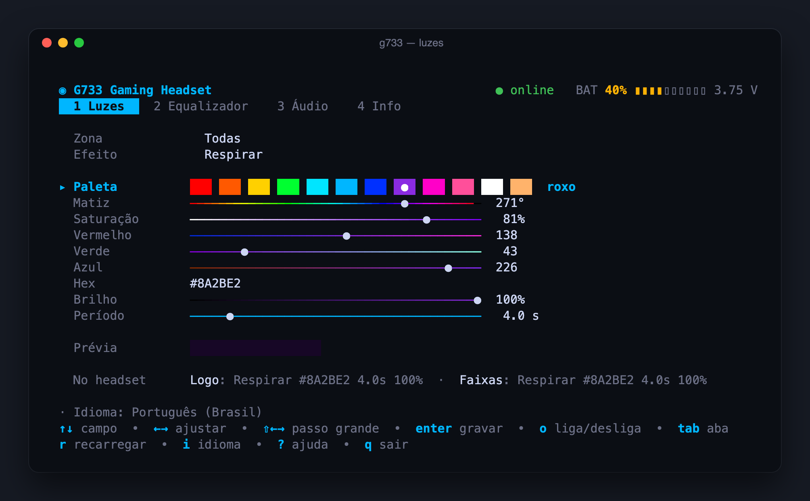
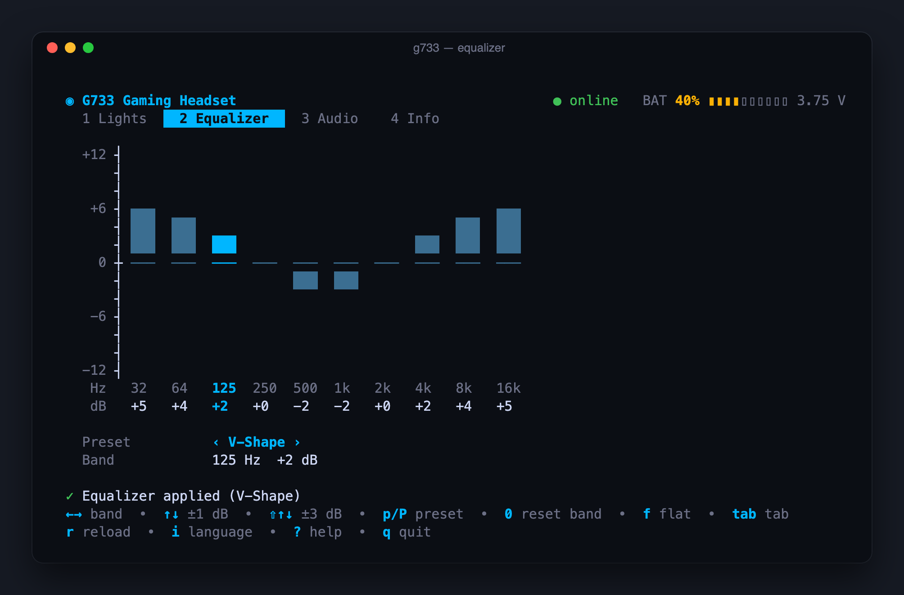

# g733 — controle do Logitech G733 sem G HUB

[English](README.md) · **Português (Brasil)**

App de terminal leve que fala **HID++ 2.0** direto com o dongle LIGHTSPEED do
Logitech G733. Ele ajusta as luzes RGB, o equalizador, o sidetone e o
auto-desligar, e mostra a bateria, sem instalar o Logitech G HUB.



- **Interface interativa** feita com [Bubble Tea](https://github.com/charmbracelet/bubbletea):
  editor RGB ao vivo com paleta, sliders de matiz/saturação/RGB, campo hex e
  prévia animada, além de equalizador gráfico de 10 bandas com presets.
- **CLI de execução única** para scripts, aliases e atalhos globais
  (`g733 lights off`, `g733 eq preset graves`…).
- **Inglês e português**, alternáveis a qualquer momento.
- **Binário autocontido**: o hidapi vai compilado junto. O app nunca toma
  acesso exclusivo ao dongle, então a roda de volume e as teclas de mídia do
  headset continuam funcionando enquanto ele roda.

## Requisitos

- Logitech **G733** com o receptor USB LIGHTSPEED (IDs `046d:0ab5`, `0afe` ou
  `0b1f`).
- **macOS** (desenvolvido e testado em Apple Silicon). A camada HID
  ([go-hid](https://github.com/sstallion/go-hid)) também suporta Linux e
  Windows, mas não foi testada neles.
- **Go 1.25+** com cgo (Xcode Command Line Tools no macOS) para compilar.

## Instalação

```bash
go install github.com/felipearomani/g733-control/cmd/g733@latest
```

O binário vai para `$(go env GOPATH)/bin` (normalmente `~/go/bin`). Confira se
esse diretório está no `PATH`.

Ou a partir do clone:

```bash
git clone https://github.com/felipearomani/g733-control.git
cd g733-control
make install      # compila e instala ~/go/bin/g733
make test         # testes unitários (não precisam do headset)
```

## Primeiros passos

1. Conecte o receptor e ligue o headset.
2. Rode `g733 --lang pt-br`, ou `g733 lang pt-br` uma vez para deixar o
   português como padrão. O cabeçalho fica verde (**● online**) e mostra a
   bateria.
3. Use `tab` (ou `1`–`4`) para trocar de aba, `↑ ↓` para escolher o campo e
   `← →` para ajustar. As mudanças vão para o headset **ao vivo**.
4. Na aba Luzes, `enter` **grava** as luzes no headset para que persistam
   depois de desligar.
5. `?` mostra todos os atalhos e `q` sai.

## Usando a interface

### Teclas gerais

| Tecla | Ação |
|---|---|
| `tab` / `shift+tab`, `1`–`4` | Trocar de aba |
| `↑ ↓` (ou `k j`) | Mover entre campos |
| `← →` (ou `h l`) | Ajustar o valor / trocar a opção |
| `shift+← →` (ou `H L`) | Passo grande |
| `r` | Reler tudo do headset |
| `i` | Trocar idioma (English ⇄ Português) |
| `?` | Ajuda |
| `q`, `ctrl+c` | Sair |

Se o headset desligar ou o dongle for removido, o app espera e reconecta
sozinho.

### 1 · Luzes

O G733 tem duas zonas de LED, **Logo** e **Faixas**. Com **Zona** = `Todas`
as duas mudam juntas; escolha uma para ajustá-la sozinha.

| Campo | O que faz |
|---|---|
| Efeito | `Desligado`, `Cor fixa`, `Respirar`, `Ciclo de cores` |
| Paleta | 12 cores prontas (`← →` para navegar) |
| Matiz / Saturação | Escolha de cor em HSV; o slider mostra a cor resultante |
| Vermelho / Verde / Azul | Valor exato de cada canal, 0–255 |
| Hex | Digite `RRGGBB`; aplica ao completar 6 dígitos |
| Brilho | 0–100 %. Escala a cor na Cor fixa; define a intensidade em Respirar/Ciclo |
| Período | Velocidade do Respirar / Ciclo, de 0,5 s a 30 s |

- A **Prévia** anima o efeito no terminal, e **No headset** mostra o que o
  headset reporta em cada zona.
- As edições aplicam ao vivo, mas só ficam na RAM. **`enter`** (ou `s`) grava
  na flash do headset. **`o`** apaga as luzes e volta ao último estado aceso.

### 2 · Equalizador



Dez bandas de 32 Hz a 16 kHz, ±12 dB cada.

| Tecla | Ação |
|---|---|
| `← →` | Escolher banda |
| `↑ ↓` | ±1 dB |
| `shift+↑ ↓`, `pgup`/`pgdown` | ±3 dB |
| `p` / `P` | Próximo / anterior preset |
| `0` | Zerar a banda selecionada |
| `f` | Flat (todas as bandas em 0 dB) |

Presets: Flat, Reforço de graves, Grave + Agudo (V), Voz / Podcast,
FPS / Passos, Agudos, Cinema, Música (quente).

### 3 · Áudio

- **Sidetone**: quanto da sua própria voz você ouve no fone (0 = desligado).
- **Auto-desligar**: minutos sem uso até o headset desligar sozinho
  (`Nunca`, 5 min … 4 h).

### 4 · Info

Nome, product ID USB, firmware, tensão da bateria, zonas de LED, faixa do EQ e
a tabela completa de features HID++ que o headset informa.

## Usando a CLI

Cada subcomando abre o dongle, faz uma coisa e sai. `g733 help` lista tudo.

```bash
g733 status                          # bateria, luzes, EQ, sidetone, auto-desligar
g733 info                            # firmware, features HID++, zonas, bandas
g733 battery

g733 lights                          # efeito atual de cada zona
g733 lights off
g733 lights static vermelho          # nomes: vermelho laranja amarelo verde ciano logitech
                                     #        azul roxo magenta rosa branco quente
g733 lights static ff8800 --brightness 40
g733 lights breathe 00b6ff --period 3000 --zone logo
g733 lights cycle --period 8000
g733 lights static roxo --temp       # --temp: não grava na flash

g733 eq                              # bandas e ganhos atuais
g733 eq presets
g733 eq preset graves                # qualquer trecho do nome, em inglês ou português
g733 eq set 3,2,1,0,0,0,1,2,3,3      # um ganho (dB) por banda
g733 eq flat

g733 sidetone 20                     # 0-100
g733 autooff 30                      # minutos, 0 = nunca
g733 raw 1f20 0                      # chamada HID++ crua (avançado)
```

`--zone` aceita `logo`, `faixas` (ou `strips`) e `todas` (padrão). Cores
aceitam `RRGGBB`, `#RRGGBB`, `#RGB` ou um nome em inglês ou português.

## Idioma

A interface e a CLI falam **inglês** e **português do Brasil**. Vale a
primeira regra que bater:

1. `--lang en` / `--lang pt-br` na linha de comando
2. a variável de ambiente `G733_LANG`
3. a preferência salva (`g733 lang pt-br`, ou `i` na interface)
4. `LC_ALL`, `LC_MESSAGES`, `LANG`
5. inglês

## Ideias de automação

```bash
alias luz-off='g733 lights off'
alias jogo='g733 lights cycle --period 6000 && g733 eq preset fps'
alias reuniao='g733 lights static quente --brightness 30 && g733 eq preset voz && g733 sidetone 25'
```

Dá para ligar esses comandos a atalhos com Raycast, Hammerspoon ou skhd.

## Como funciona

O dongle LIGHTSPEED expõe uma interface HID vendor-defined (usage page
`0xFF43`) que transporta relatórios HID++ longos de 20 bytes. O `g733` não usa
índices fixos: pergunta à feature Root (`0x0000`) onde fica cada feature e
descobre zonas, efeitos e bandas do próprio headset. A tabela de features e a
organização do código estão no [README em inglês](README.md#how-it-works).

A porcentagem da bateria é uma estimativa por curva de tensão: o headset
informa milivolts, não porcentagem.

## Problemas comuns

| Sintoma | O que fazer |
|---|---|
| *Dongle LIGHTSPEED não encontrado* | Conecte o receptor. Confira se ele aparece: `ioreg -p IOUSB \| grep -i G733` |
| *Headset desligado ou fora de alcance* | Ligue o headset e confira se está pareado com esse receptor. |
| As luzes voltam à cor antiga depois de desligar | A mudança ficou só na prévia. Aperte `enter` na interface ou use a CLI sem `--temp`. |
| Ajustes sendo sobrescritos | Feche o Logitech G HUB se estiver aberto. Ele também escreve no headset. |

## Créditos

Conhecimento de protocolo vindo do [HeadsetControl](https://github.com/Sapd/HeadsetControl),
do [Solaar](https://github.com/pwr-Solaar/Solaar) e do
[libratbag](https://github.com/libratbag/libratbag). Interface feita com
[Bubble Tea](https://github.com/charmbracelet/bubbletea),
[Bubbles](https://github.com/charmbracelet/bubbles) e
[Lip Gloss](https://github.com/charmbracelet/lipgloss).

Sem afiliação nem endosso da Logitech.

## Licença

[MIT](LICENSE) © Felipe Romani
